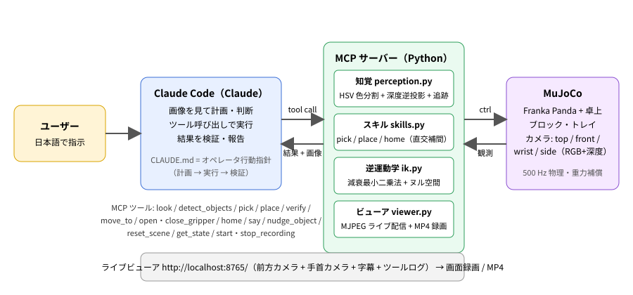

# Claude Robot Operator — Claude Code が MCP 経由でロボットアームを自然言語で操作する

Physical AI 応用 1 講座 最終課題「AI × ロボティクスによる創造的タスクの実現」の提出物です。

**Claude Code（LLM エージェント）が MCP（Model Context Protocol）ツールを通じて、MuJoCo 上の Franka Panda アームを
日本語の指示だけで操作します。** Claude はカメラ画像を見て計画を立て、把持・設置のスキルを呼び出し、
結果を画像と知覚結果で検証してから報告します。API キーは不要で、Claude Code をこのリポジトリで開くだけで動きます。

- 動画: https://youtu.be/7DrWkL0cJXM（YouTube、タイトル `PAI最終課題_83473`、等速）
- レポート: [docs/report.md](docs/report.md)



## 何ができるか

```
ユーザー: 赤いブロックを青いトレイに入れて、緑のブロックを赤いブロックの上に積んでください
Claude  : look("top") → 物体 ID と位置を把握
          say("赤いブロックを青いトレイに運びます") → pick("red_cube") → place("blue_tray")
          verify("red_cube", "blue_tray") → OK
          pick("green_cube") → place("red_cube") → verify(...) → look("front")
          「赤いブロックは青いトレイの中央（誤差 2 mm）、緑のブロックはその上に積めたことを確認しました」
```

- **仕分け**: 「赤いブロックは赤いトレイへ、青は青いトレイへ」— 同色のブロックが複数あっても順に処理し、トレイ内の空き位置を自動で選ぶ
- **積み上げ**: 「大きい順に積んで」— サイズを知覚結果から判断して段積み
- **曖昧さへの対応**: 指示が曖昧なときは確認し、常識で決められることは `say()` で宣言して進める
- **外乱からの回復**: `nudge_object` で人が物体を動かした状況を再現し、再検出してやり直す
- **実況**: Claude の発話（`say`）がライブ画面と録画の字幕になる

## 仕組み

| 層 | 役割 | 実装 |
|---|---|---|
| 判断（AI） | 画像と検出結果から計画し、ツールを呼び、結果を検証して報告 | Claude Code（Claude）。行動指針は [CLAUDE.md](CLAUDE.md) |
| インターフェース | 15 個のツールを MCP で公開 | [robot_mcp/server.py](robot_mcp/server.py)（FastMCP, stdio） |
| 知覚 | トップカメラの RGB + 深度から、HSV 色分割 × 高さマップで物体を検出し、深度を逆投影して世界座標・サイズ・向きを推定。呼び出し間で ID を追跡 | [robot_mcp/perception.py](robot_mcp/perception.py) |
| スキル | pick / place / home。直交座標で補間した経路を 50 Hz で IK に通し、位置サーボへ指令。把持の成否は指間隔から判定 | [robot_mcp/skills.py](robot_mcp/skills.py) |
| 逆運動学 | 減衰最小二乗法（位置 + 姿勢 6 自由度）＋ヌル空間でホーム姿勢へ | [robot_mcp/ik.py](robot_mcp/ik.py) |
| シミュレーション | MuJoCo。`MjSpec` で Panda（mujoco_menagerie）にテーブル・ブロック・トレイ・4 台のカメラを動的に追加。重力補償つき | [robot_mcp/sim.py](robot_mcp/sim.py) |
| 可視化 | MJPEG のライブビューア（前方 + 手首カメラ + 字幕 + ツールログ）と MP4 録画 | [robot_mcp/viewer.py](robot_mcp/viewer.py) |

シミュレータの真値（物体の絶対座標）は Claude にもスキルにも渡しません。位置はすべてカメラ画像からの推定です
（`nudge_object` の外乱注入のみ内部状態を書き換えます）。

### MCP ツール

| ツール | 説明 |
|---|---|
| `look(camera)` | `front` / `top`（検出結果を注記）/ `wrist` / `side` の画像を返す |
| `detect_objects()` | 物体の ID・色・種類・位置・サイズ・向き（JSON） |
| `pick(object_id)` | 把持して持ち上げる。成否と手首カメラ画像を返す |
| `place(target, dx, dy)` | トレイの中（空き位置を自動選択）/ ブロックの上 / 座標へ置き、ホームに戻って結果を検証 |
| `verify(object_id, target)` | 物体が目標の中・上にあるかを知覚結果から判定 |
| `move_to`, `open_gripper`, `close_gripper`, `home` | 低レベル操作 |
| `say(text)` | 発話（字幕）。`ROBOT_TTS=1` で macOS の `say` が読み上げる |
| `nudge_object(object_id, dx, dy)` | 外乱注入（人が物体を動かした状況） |
| `reset_scene(layout, seed)` | `basic` / `sorting` / `stacking` / `random` |
| `get_state`, `start_recording`, `stop_recording` | 状態取得・録画 |

## セットアップ

macOS（Apple Silicon）/ Linux、Python 3.10〜3.13。GPU 不要。

```bash
git clone https://github.com/Kaito-Furuo/pai1_final.git
cd pai1_final
python3.12 -m venv .venv
.venv/bin/pip install -r requirements.txt
PYTHONPATH=. .venv/bin/python scripts/test_pick_place.py scratch   # 動作確認（動画と画像を scratch/ に出力）
```

## 使い方

### 1. Claude Code から操作する（本番）

このディレクトリで Claude Code を開くと [.mcp.json](.mcp.json) の MCP サーバー `robot` が起動します
（初回は MCP サーバーの承認を求められます）。ブラウザで http://localhost:8765/ を開くとライブ映像が見えます。

```
> 赤いブロックを青いトレイに入れて
> ブロックを色ごとに仕分けして
> 大きい順に積み上げて。終わったら前のカメラで見せて
> （途中で）緑のブロックを動かしちゃった。やり直して
```

### 2. ヘッドレスで再現する（`claude` CLI）

```bash
.venv/bin/python scripts/run_claude_demo.py --name demo1 --layout basic \
  "赤いブロックを青いトレイに入れて、緑のブロックを赤いブロックの上に積んでください"
```

`recordings/demo1/` に自動録画の MP4、全イベント（発話・ツール呼び出し・結果）の `events.jsonl`、
ツールログ `tool_log.jsonl` が保存されます。

### 3. 動画を作る（ヘッドレス実行の記録から）

```bash
.venv/bin/python scripts/compose_video.py --run recordings/demo1 --max-gap 4   # 左: シミュレータ / 右: チャット の 1080p 動画
.venv/bin/python scripts/finalize_video.py --run recordings/demo1 --speed 2    # タイトルカード + 2 倍速
```

`recordings/demo1/chapters.json` を置くと、タスクの切り替わりにタスク文だけのスライドを挟み、以降は映像の左下に
現在のタスクを常時表示します（書式は `scripts/compose_video.py` 冒頭のコメント参照）。`finalize_video.py` は
`--intro/--outro`（前後に付ける映像）、`--overview`（「動画の見方」カード）、`--end`（まとめカード）も受け付けます。

### 4. Claude なしで動かす

```bash
PYTHONPATH=. .venv/bin/python scripts/scripted_demo.py --layout sorting --record sorting   # スクリプトデモ
PYTHONPATH=. ROBOT_REALTIME=0 .venv/bin/python scripts/benchmark.py --trials 20              # 成功率ベンチマーク
PYTHONPATH=. .venv/bin/python scripts/test_perception.py scratch                             # 知覚精度の検証
```

環境変数: `ROBOT_REALTIME`（実時間比、0 で最速）、`ROBOT_RENDER`（例 `1280x960`）、`ROBOT_LAYOUT`、`ROBOT_TTS`。

## ディレクトリ

```
robot_mcp/          MCP サーバー・シミュレーション・知覚・スキル・IK・ビューア
robot_mcp/assets/   mujoco_menagerie の Franka Panda モデル（Apache-2.0）
scripts/            テスト・デモ・ベンチマーク・CLI ドライバ・動画合成
docs/               レポート・構成図
CLAUDE.md           Claude（オペレータ）の行動指針
.mcp.json           Claude Code 用の MCP サーバー設定
```

## 工夫した点

1. **AI の役割分担**: LLM は「何をどの順で、どう確認するか」の判断に専念し、精密な位置決めは古典的な知覚と IK に任せる。
   ツールは「失敗を検出して報告する」設計（把持後の指間隔、設置後の再検出と誤差）で、Claude が検証ループを回せる。
2. **画像ベースの知覚**: 真値を使わず、トップカメラの RGB と深度だけで位置（誤差 2〜4 mm）・サイズ・向きを推定。
   高さマップで「同色のトレイの中のブロック」も分離し、操作による移動を追跡 ID に反映する。
3. **API キー不要・再現容易**: Claude Code と MCP だけで動く。`claude` CLI のヘッドレス実行で同じデモを再現でき、
   録画・イベントログから動画を合成できる。
4. **見せ方**: Claude の発話が字幕になるライブビューア。手首カメラの小窓で把持の様子が分かる。

## 評価（詳細は [docs/report.md](docs/report.md)）

| 項目 | 結果 |
|---|---|
| 知覚（ランダム 40 シーン、249 物体、真値と比較） | 検出 249 / 249、ブロック位置誤差 平均 1.4 mm・最大 3.2 mm |
| ピック＆プレース（ランダム 20 シーン、73 ブロック） | 把持 73 / 73、トレイ内への設置検証 OK 73 / 73、設置誤差 中央値 3.4 mm・最大 10.5 mm |
| Claude による自律実行（3 作業: 運搬・仕分け・積み上げ） | 3 / 3 完了、47 ターン、167 秒、ロボットツール呼び出し 45 回 |

## ライセンス

- このリポジトリのコード: MIT
- `robot_mcp/assets/menagerie/franka_emika_panda/`: [mujoco_menagerie](https://github.com/google-deepmind/mujoco_menagerie)（Apache-2.0、同梱の LICENSE を参照）
