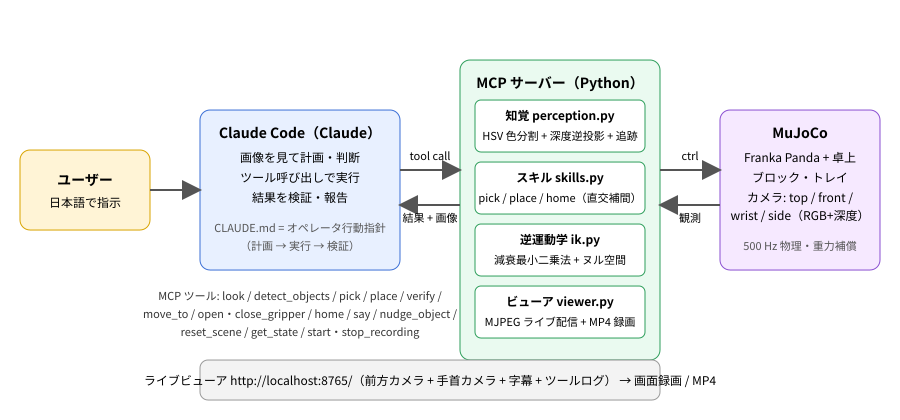
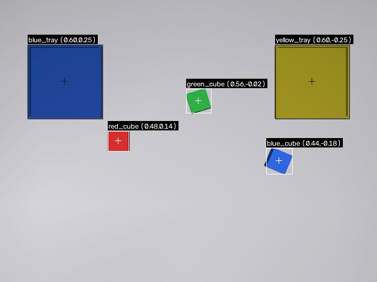
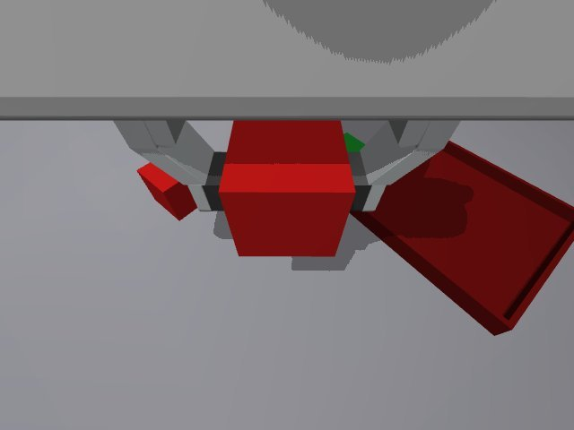
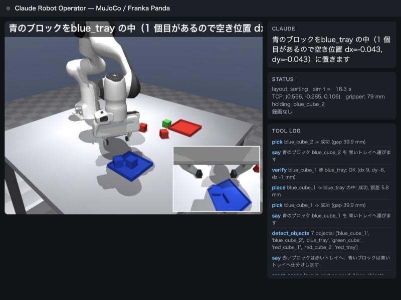
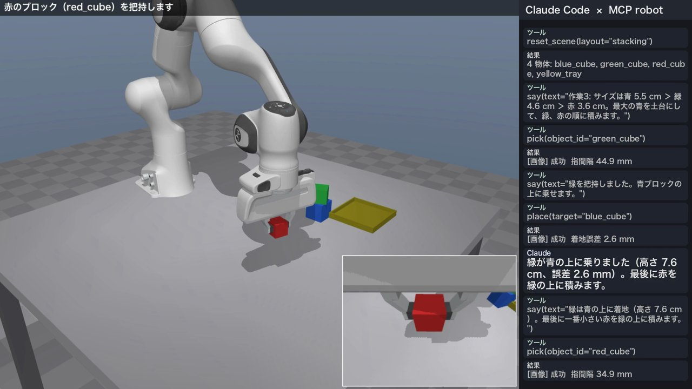

# Physical AI 応用 1 講座 最終課題 説明資料

**題名: Claude Robot Operator — LLM エージェント（Claude Code）が MCP 経由でロボットアームを自然言語操作する**

- 使用ツール: MuJoCo 3.17（Franka Panda, mujoco_menagerie）、Python 3.12、Claude Code + MCP（Model Context Protocol）
- コード: https://github.com/Kaito-Furuo/pai1_final
- 動画: （YouTube URL）

---

## 1. 概要と目的

本課題では、**大規模言語モデル（Claude）を「ロボットのオペレータ」として使い、日本語の指示だけで卓上の
ピック＆プレース作業を実行・検証させるシステム**を構築した。

近年の Physical AI では、VLA（Vision-Language-Action）モデルのように画素から直接アクションを出す方式と、
LLM が計画・判断を担い、実行は古典的な制御に委ねる方式がある。本作品は後者の構成を、
**Claude Code の標準機能である MCP ツール呼び出しだけで実現**した点が特徴である。
追加の学習も API キーも不要で、リポジトリを Claude Code で開くだけで「AI がロボットを操作する」体験が再現できる。

狙いは次の 3 点である。

1. **AI の役割分担を明確にする**: LLM は「何を・どの順で・どう確認するか」という判断に専念し、
   精密な位置決めは画像処理と逆運動学に任せる。
2. **閉ループで検証する**: ツールは成功/失敗を正直に返し（把持後の指間隔、設置後の再検出誤差）、
   Claude がそれを見て再試行・再計画する。確認していないことを「できた」と言わせない。
3. **人に分かる形で見せる**: Claude の発話を字幕にしたライブ映像と手首カメラで、判断と動作の対応が一目で分かる。

## 2. システム構成

| 層 | 内容 |
|---|---|
| 判断（AI） | Claude Code。`CLAUDE.md` に「把握 → 宣言 → 実行 → 検証 → 報告」の行動指針を記述。カメラ画像（JPEG）と検出結果（JSON）を見て、ツール呼び出しで行動する |
| MCP サーバー | Python（FastMCP, stdio）。15 ツール: `look` / `detect_objects` / `pick` / `place` / `verify` / `move_to` / `open_gripper` / `close_gripper` / `home` / `say` / `nudge_object` / `reset_scene` / `get_state` / `start_recording` / `stop_recording` |
| 知覚 | トップカメラの RGB + 深度。HSV 色分割 × 高さマップ（深度の逆投影）で「ブロック」と「トレイ」を分離し、連結成分ごとに世界座標・一辺の長さ・向き（minAreaRect）を推定。呼び出し間で最近傍マッチにより ID を追跡し、操作で動かした物体は追跡位置を更新する |
| スキル | `pick`: 上空 → 下降 → 閉 → 持ち上げ、指間隔で把持判定。`place`: 上空 → 下降 → 開 → 退避 → ホーム復帰 → 再検出で誤差を算出。トレイ内に既にブロックがあれば干渉しない空き位置を自動選択 |
| 逆運動学 | 減衰最小二乗法（位置 3 + 姿勢 3）。ヌル空間でホーム姿勢へ寄せ、関節限界でクリップ。直交座標で補間した経路を 50 Hz で解く（1 回 1 ms 未満） |
| シミュレーション | MuJoCo。`MjSpec` でテーブル・ブロック・トレイ・4 台のカメラ・TCP サイトを動的に追加。500 Hz、楕円摩擦錐、重力・コリオリ項を補償して位置サーボのたわみを除去 |
| 可視化 | MJPEG のライブビューア（前方カメラ + 手首カメラの小窓 + 字幕 + ツールログ）。MP4 録画とフレームの壁時計を保存し、Claude の発話ログと合成できる |

**真値は渡さない。** Claude にもスキルにも、シミュレータ内部の物体座標は渡していない。位置はすべてカメラ画像からの推定である
（外乱注入 `nudge_object` だけが内部状態を書き換える）。

 

左: トップカメラの検出結果（ID と位置を注記して Claude に渡す画像）。右: 把持直後の手首カメラ（Claude はこれで把持を確認する）

ライブビューア（前方カメラ + 手首カメラの小窓 + Claude の発話 + 状態 + ツールログ）

## 3. デモの内容（動画）

| 場面 | 指示 | 見どころ |
|---|---|---|
| 1 | 赤いブロックを青いトレイに入れて | 把握 → 宣言 → 把持 → 設置 → 検証の基本ループ。手首カメラで把持が見える |
| 2 | ブロックを色ごとに仕分けして | 同色 2 個ずつ。順番を自分で決めて宣言し、トレイ内の空き位置に並べる |
| 3 | 大きい順に積み上げて | 知覚したサイズから順序を判断し、ブロックの上に設置（支持面の高さを検出） |
| 4 | （人が物体を動かす）やり直して | `nudge_object` で外乱。再検出して ID を引き継ぎ、やり直す |

動画の構成: 左がシミュレータ（字幕は Claude の say()）、右が Claude Code のチャット（指示・発話・ツール呼び出し）

## 4. 評価

### 4.1 知覚精度（シミュレータ真値との比較）

ランダム配置 40 シーン、計 249 物体（6 色のブロック 35〜45 mm + トレイ 2 個）。

| 項目 | 結果 |
|---|---|
| 検出（色・種類・位置が真値と一致） | 249 / 249（誤検出・取りこぼしなし） |
| ブロック位置誤差（xy） | 平均 1.4 mm、最大 3.2 mm |
| 一辺の推定 | 全物体で真値 ±4 mm 以内（多くは ±1 mm） |
| 向き（yaw） | 誤差 1° 以内（90° 対称を考慮） |

開発中に見つかった落とし穴: 鏡面反射と真上からのライトで天面が白く飽和し、黄色とオレンジが同じ色相に潰れていた。
マット材質にして照明を飽和しない強さに下げ、色相の境界を実測に合わせて決め直した（レポート末尾の反省点も参照）。

### 4.2 ピック＆プレース成功率（ランダム配置）

`scripts/benchmark.py`: ランダムな色・サイズ（35〜45 mm）・位置・向きのブロック 3〜5 個を、
2 つのトレイへ交互に運ぶ。20 シーン。

| 項目 | 結果 |
|---|---|
| 試行数（ブロック数の合計） | 73 |
| 把持成功 | 73 / 73 |
| 設置後の検証 OK（トレイ内に収まっている） | 73 / 73 |
| 設置誤差（目標との xy） | 中央値 3.4 mm、90 パーセンタイル 6.7 mm、最大 10.5 mm |
| 所要時間 | 312 秒（実時間比なしの最速実行、1 ブロックあたり約 4.3 秒） |

設置時に「下降が目標に届かない」警告が 1 件出たが、トレイ内の検証は通っている（既存ブロックの近くでわずかに干渉した）。
トレイに 2 個目以降を置くときは、検出した既存ブロックと干渉しない空き位置を自動で選ぶ。

### 4.3 Claude による自律実行（動画の本編）

`scripts/run_claude_demo.py` で Claude Code（claude-fable-5-1）をヘッドレス起動し、1 つの指示文で
「①赤ブロックを青トレイへ ②sorting シーンで色ごとに仕分け ③stacking シーンで大きい順に積み上げ ④まとめ」を依頼した。

| 項目 | 結果 |
|---|---|
| 完了した作業 | 3 / 3（すべて `verify` で位置を確認してから次へ進んだ） |
| 対話ターン数 / 所要時間 | 47 ターン / 167 秒（うちロボット動作 67 秒、残りは Claude の推論と画像の確認） |
| ロボットツール呼び出し | 45 回（`say` 16、`verify` 8、`pick` 7、`place` 7、`home` 3、`reset_scene` 2、`detect_objects` 1、`look` 1） |
| 把持・設置 | 把持 7 / 7、設置 7 / 7（仕分けでは同じトレイに 2 個を dx=±3 cm で前後に並べる判断を自分で行った） |
| 積み上げ | 検出したサイズ（5.5 / 4.6 / 3.6 cm）から「青 → 緑 → 赤」の順を決め、3 段を完成 |

別の試行（同モデル、基本シーンで「赤を青トレイへ、緑を赤の上に積む」）では、積み上げ後の `verify` が
「上カメラから下のブロックが隠れる」ために不合格を返した。Claude は横カメラと前方カメラの画像で再確認し、
「不合格は遮蔽による誤検出」と正しく報告した。この経験から、隠れた物体は最後に検出した位置で判定する
フォールバックと、遮蔽による残片を除外する処理を知覚モジュールに追加した。

## 5. 工夫した点

1. **ツール設計 = AI へのインターフェース設計**。ツールは必ず「成否と根拠」を返す（指間隔、再検出誤差、画像）。
   曖昧な ID を渡されたら候補一覧を返し、Claude が自分で修正できる。`place` は置いた後に自動でホームに戻って
   上から再検出するので、Claude は「置けたか」を数値で知れる。
2. **真値に頼らない知覚**。色だけでは同色トレイの中のブロックが消えるため、深度から高さマップを作り
   「2.5 cm より高い色付き領域 = ブロック」と分離した。腕に遮られて一時的に消えた物体も追跡 ID を維持する。
3. **重力補償と直交補間**。位置サーボだけでは遠方で 10 mm 以上たわんだため、`qfrc_bias` を補償して設置誤差を 2 mm 台にした。
4. **再現性と見せ方**。`claude` CLI のヘッドレス実行で同じデモを再現でき、録画・イベントログから動画を合成できる。
   Claude の `say()` を字幕にすることで「AI の判断」と「ロボットの動作」の対応が動画で分かる。

## 6. 反省点・今後

- 物体はブロックとトレイに限っており、知覚は色に依存している。実機ならセグメンテーションモデル（例: SAM）や
  VLM による物体認識に置き換える必要がある。ツールのインターフェースは変えずに差し替えられる設計にした。
- 把持は上からの平行把持のみ。姿勢の自由度や障害物回避は未実装。
- LLM の判断は非決定的で、同じ指示でも手順が変わる。評価はヘッドレス実行を複数回回して記録した。
- 実機（例: SO-101）への展開は、スキル層を実機の制御 API に差し替えれば MCP ツールと Claude 側はそのまま使える。

## 7. 使用した外部資源

- MuJoCo（Apache-2.0）、mujoco_menagerie の Franka Panda モデル（Apache-2.0）
- Claude Code / MCP Python SDK（MIT）、OpenCV、NumPy、imageio、Pillow
- 開発には Claude Code を使用した（設計・実装・検証の対話）。
